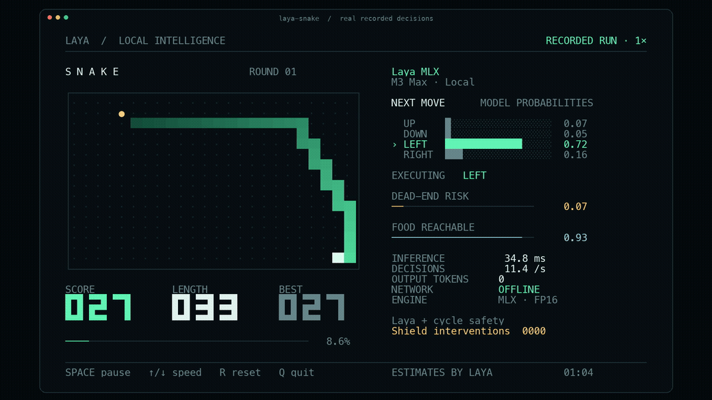

# otsone

**openjev's own calibrated typed-decision model toolkit** — Choice / Score / Noul, for CPU/edge and Apple silicon.

`otsone-1` (model family **`openjev`**) is a compact typed-decision model trained from scratch in this repo: a rank-consistent CORN ordinal head, calibration-native training, and a strictly-proper reliability report (**accuracy 1.0 / ECE 0.094** on the small in-repo gold set, which is not a held-out benchmark — [method](docs/RESEARCH-OTSONE.md); public-dataset numbers for the site's engines are on the `/leaderboard` page). It serves through a stdlib ONNX sidecar and runs on plain CPU/edge as well as Apple silicon.

This toolkit **also runs the Laya models** (Convai Innovations, Apache-2.0) natively on Apple silicon via MLX. Laya is a fully-supported, attributed model here — not the project's brand. The MLX engine (`laya_mlx`) keeps its name because it is the Laya-derived architecture that `otsone-1` builds on.

[中文](README.zh-CN.md) · [otsone-1 model](docs/OUR-MODEL.md) · [otsone research](docs/RESEARCH-OTSONE.md) · [Benchmarks](BENCHMARKS.md) · [Snake demo](docs/SNAKE_DEMO.md)

## Quick start

`otsone` is not published to PyPI yet; install it from a clone of this repository:

```bash
git clone https://github.com/caelum0x/openjev
pip install ./openjev/otsone      # or, inside otsone/: uv sync
```

The primary command-line tools are `otsone` and `otsone-serve`. `laya-mlx` and `laya-serve` remain as backward-compatible aliases.

### otsone-1 — the flagship model (train → eval → serve)

`otsone-1` is trained in this repo and served through the ONNX backend on CPU/edge:

```bash
pip install 'otsone[train]'
otsone distill --backbone otsone-base --out models/otsone-base      # train
otsone eval    --model models/otsone-base                            # gold eval + reliability
OTSONE_BACKEND=onnx OTSONE_MODEL_PATH=./models/otsone-base otsone-serve
#   GET  /health        -> {"ok": true, "engine": "laya-onnx", "model": "otsone-1"}
#   POST /v1/systemone  {"state": ..., "questions": {...}} -> {"model","answers","usage"}
```

The sidecar reads `OTSONE_*` settings first, falling back to the `LAYA_*` aliases. Full architecture, corpus and calibration details: [docs/OUR-MODEL.md](docs/OUR-MODEL.md).

### Run a typed decision (the Laya model, Apple silicon)

The immediately-installable inference path uses the published Laya checkpoints (Convai Innovations, Apache-2.0):

```python
import otsone  # public API; `import laya_mlx as laya` also works

agent = otsone.load("aac6fef/laya-mlx")
result = agent.predict(
    "I was billed twice. Please refund the duplicate.",
    {
        "department": {
            "type": "choice",
            "instructions": "Who should handle this?",
            "criteria": ["billing", "technical", "sales"],
        }
    },
)
print(result["answers"]["department"])
```

Apple Silicon, Python 3.11+, macOS 14+. First load downloads the checkpoint; later inference is fully local. The measured environment is macOS 27.2, Python 3.12.13 and MLX 0.32.2. That MLX release supplies macOS 14, 15 and 26 wheels; the local installer selected the 26 wheel. Older supported macOS versions were not tested on this machine.

Run the terminal demo (a real local Snake run driven by the Laya model):



```bash
pip install 'otsone[demo]'
hf download aac6fef/laya-multilingual-mlx
laya-snake
```

Every move calls the Laya model; the visible cycle safety layer can correct unsafe proposals. Download once before the offline demo. Use a terminal at least 104 × 35 cells. Space pauses, ↑/↓ changes speed, R resets and Q quits. `laya-snake --max-speed` makes a fresh decision for every move without pacing. [Watch the 30-second MP4](docs/assets/snake-demo.mp4) · [Recording, controls and exact metric meanings](docs/SNAKE_DEMO.md).

`laya-snake --optimize --max-speed` enables the tested compilation and prefix-reuse path: **75.40 moves/s across 2,400 moves**, zero deaths and 2 visible safety interventions in the paired M3 Max test. This was about **6.5% faster** than its same-run eager control. [Gameplay, performance and correctness evidence](docs/SNAKE_OPTIMIZATION.md).

## Laya model performance on M3 Max

The latency table below measures the **Laya models** running on the MLX engine (the Apple-silicon path). `otsone-1`'s own quality metrics (accuracy / ECE / reliability) are reported in [docs/RESEARCH-OTSONE.md](docs/RESEARCH-OTSONE.md).

| FP16, end-to-end | Laya 421M | Multilingual 322M |
|---|---:|---:|
| One short question, P50 | **13.42 ms** | **7.39 ms** |
| One short question, P95 | **13.92 ms** | **7.79 ms** |
| 50-question throughput | **146.8 q/s** | **395.0 q/s** |
| Peak MLX allocation, one short question | **943.6 MiB** | **687.6 MiB** |

M3 Max, 40 GPU cores, 128 GiB memory. Timing includes prompt preparation, tokenization, tensors, synchronized inference, calibration and result formatting; model loading is excluded. The 50-question measurement uses `batch_size=64`; the API defaults to 16. Different lengths, question counts and runtime conditions change latency. [Full method and every timing sample](BENCHMARKS.md).

**Port fidelity:** all three checkpoints matched the upstream selected answer on **63/63 validation questions in both FP32 and FP16** — 378/378 comparisons. Each configuration also passed 100 repeated finite, deterministic calls with zero measured active-memory growth. This measures fidelity on those fixtures, not accuracy on every possible question. [Probability errors and validation](BENCHMARKS.md#numerical-parity-and-stability).

## Why typed decisions?

Software often needs a choice, a rubric score or a probability. Laya answers those constrained questions in a bidirectional forward pass, without token-by-token decoding or generated JSON.

```text
state + typed question → bidirectional encoder → decision heads → probabilities
```

- `choice`: probabilities over named options.
- `score`: probabilities over ordered rubric levels and their expected score.
- `noul`: P(true) for a proposition.

Question rows are batched independently. Their bidirectional encoder representations depend on both state and question; this runtime does not claim to encode the state once and reuse its hidden states across arbitrary questions.

The encoder, decision Transformer, scoring head and action head all run in MLX. Tokenization uses Hugging Face's Rust tokenizer. The original pretrained weights, question formatting, calibration and output schema are retained. This is an independent MLX port, not an official Convai Innovations release.

## Supported checkpoints

| Model | Encoder | Parameters | Context limit | Purpose |
|---|---|---:|---:|---|
| `convaiinnovations/laya` | ModernBERT-large | 421M | 512 | English |
| `convaiinnovations/laya-multilingual` | mmBERT-base | 322M | 1,024 | Multilingual input |
| `convaiinnovations/laya-typed-decisions` | ModernBERT-large | 421M | 1,024 | Upstream typed-decisions workflows |

Context includes instructions, options and state. All three use the original weights, prompt formatting, temperature calibration, and output schema. This repository provides inference and conversion; RLCD training and fine-tuning remain in the upstream project. It is an independent port, not an official Convai Innovations release.

Pre-converted FP16 checkpoints are published on Hugging Face:

- [aac6fef/laya-mlx](https://huggingface.co/aac6fef/laya-mlx)
- [aac6fef/laya-multilingual-mlx](https://huggingface.co/aac6fef/laya-multilingual-mlx)
- [aac6fef/laya-typed-decisions-mlx](https://huggingface.co/aac6fef/laya-typed-decisions-mlx)

Load these directly with `laya.load("aac6fef/laya-mlx")`, or use the original checkpoint IDs above. Each published checkpoint includes its model card, validation results, provenance, license and file checksums. All 36 published files passed strict remote checksum verification; pinned revisions and weight hashes are recorded in [hub-publication.json](benchmarks/results/hub-publication.json).

## Development install

```bash
gh repo clone caelum0x/openjev
cd openjev/otsone
uv sync --extra demo
uv run --extra demo laya-snake
```

Or install the latest GitHub revision with `pip install 'git+https://github.com/caelum0x/openjev.git#subdirectory=otsone'`. Model weights are downloaded separately and are excluded from Git.

## Python API

```python
import laya_mlx as laya

agent = laya.load("aac6fef/laya-mlx", dtype="float16")
result = agent.predict(
    "I was billed twice. Please refund the duplicate today.",
    {
        "department": {
            "type": "choice",
            "instructions": "Which team should handle this request?",
            "criteria": {
                "billing": "invoices, payments, refunds",
                "technical": "bugs and outages",
                "sales": "new purchases",
            },
        },
        "urgency": {
            "type": "score",
            "instructions": "How urgent is this request?",
            "criteria": ["not urgent", "soon", "critical"],
        },
        "refund": {
            "type": "noul",
            "instructions": "Does the customer ask for money back?",
        },
    },
)
print(result["answers"])
```

`system_one` is an alias for `predict`. States can be text, JSON dictionaries, or conversation lists. `choice` accepts a dictionary or a list of unique labels; `score` returns the expected zero-based rubric level; `noul` returns P(true). Results retain upstream's four-decimal rounding, `action.act_probability`, and token usage fields.

The default precision is FP16. Use `dtype="float32"` for closer numerical agreement. Probabilities can differ slightly across precisions even when the selected label agrees; see the measured errors in [BENCHMARKS.md](BENCHMARKS.md). BF16 can be requested but is not part of the published validation matrix.

Following upstream v0.3.5, fitted calibration temperatures are clamped to `[0.5, 5.0]` before use: the shipped `choice:11+` bucket is 0.1006, which would sharpen logits ~10x and report a coin flip as near-certainty. The checkpoint's raw values remain available as `agent.temperature_raw` and `agent.temperature_by_options_raw`, and a `RuntimeWarning` names every clamped bucket at load.

`batch_size=16` caps the number of questions per forward pass; larger requests are processed in chunks. Increase it when memory allows. `device="gpu"` or `device="cpu"` selects a device explicitly; otherwise MLX's default device is used.

For repeated workloads, opt into `compile=True`, `pad_to_multiple=16` and `cache_prompts=True` when loading an Agent. The prefix cache is bounded to 128 questions and shares CPU state tokenization, while every question still gets its own encoder computation. Compilation has a first-use cost and shape specialization; padding may make some workloads slower. All three options default to disabled. [Measured Snake ablation and usage](docs/SNAKE_OPTIMIZATION.md).

```python
agent = laya.load("./models/laya", dtype="float32", batch_size=32)
# Select one checkpoint inside upstream's bundled repository:
multi = laya.load("convaiinnovations/laya", subfolder="multilingual")
# Pin a Hub revision for reproducibility:
agent = laya.load(
    "convaiinnovations/laya",
    revision="c5d78730f3493e4fe16d61507ef4b78eef7318cf",
)
```

Loading validates every parameter name and shape. Unsupported encoders and non-default RoPE scaling fail explicitly. ModernBERT's global/local attention pattern, inclusive sliding-window boundary, distinct local/global RoPE bases, and first-layer normalization behavior are preserved.

## Language routing and presets

```python
from laya_mlx import Router, triage_questions

router = Router(dtype="float16", max_loaded=2)
result = router.predict({"message": "发票被重复扣款，请退款。"}, triage_questions())
print(result["routing"])  # multilingual

# Choose the specialized checkpoint explicitly:
result = router.predict(state, questions, task="typed_decisions")
```

The router, language heuristics, email helpers and application presets are adapted from upstream. `Router(preload=True)` keeps all three checkpoints resident; `attach`, `preload`, `unload`, explicit `lang=`, and explicit `model=` are supported. Model lifecycle is guarded by a re-entrant lock, so concurrent threads share one loaded Agent instead of building duplicates; inference itself is not serialized. Typed-decisions workflow detection stays opt-in. The port preserves model limitations: English checkpoints are not substitutes for the multilingual checkpoint, and confidence does not guarantee accuracy.

Unidentified Latin-script languages (Romanian, Polish, Czech, Turkish, ...) route to the multilingual checkpoint on their non-English letters alone, rather than being silently assumed English. `detect_language(state)` reports the evidence: `language_undecided` and `diacritic_rate` alongside `language` and `is_english`.

## Shortlisting large choice sets

Choice options share one `head_max_len` token budget, so a question with hundreds of labels leaves only a few tokens per label. `predict_shortlist` embeds the state and each label, keeps the top `k` by cosine similarity, and runs a single `predict` on the reduced set. This is opt-in: `Agent.predict` still scores every criterion it is given.

```python
import laya_mlx as laya

agent = laya.load("aac6fef/laya-mlx")
embed_fn = laya.embed_fn_from_agent(agent)  # mean-pools the loaded encoder; no extra weights
result = laya.predict_shortlist(agent, state, questions, embed_fn, k=20)
print(result["shortlist"])  # which labels were kept, with cosine scores
```

A dedicated bi-encoder passed as `embed_fn` usually shortlists better than the decision checkpoint's own encoder. Probabilities on a shortlisted choice are over the kept labels only.

## Command line

```bash
uv run otsone predict \
  --model aac6fef/laya-mlx \
  --state-file examples/state.json \
  --questions examples/questions.json

uv run otsone predict \
  --model aac6fef/laya-multilingual-mlx \
  --state '发票被重复扣款，请退款。' \
  --questions examples/questions.json
```

The `laya-mlx` alias accepts the same subcommands.

## Export an MLX checkpoint

```bash
uv run otsone convert \
  --model convaiinnovations/laya \
  --dtype float16 \
  --output models/laya-mlx-fp16

uv run otsone predict \
  --model models/laya-mlx-fp16 \
  --state-file examples/state.json \
  --questions examples/questions.json
```

The export contains `model.safetensors`, encoder and agent configurations, tokenizer files and `mlx_config.json`. Existing output directories are never overwritten. This is a parameter-name/dtype conversion, not quantization or retraining. The source checkpoints already store FP16 weights; choosing FP32 increases arithmetic precision, not the precision of the source weights.

## Tests and benchmarks

```bash
uv sync --extra dev --extra reference --extra benchmark --extra demo
source .venv/bin/activate
gh repo clone NandhaKishorM/laya .upstream
git -C .upstream checkout 573e5b62696ba441230cd6be71d593331b5d23af
pytest -q
python -m benchmarks.download
python -m benchmarks.validate --repeats 100
python -m benchmarks.run --iterations 50 --warmup 5
python -m benchmarks.accuracy --per-class 64
python -m benchmarks.report
```

Run GPU measurements sequentially. Unit tests use small random models and include direct comparisons with Transformers and the pinned upstream decision head. Real checkpoint validation tests tokenization, logits, calibrated probabilities, repeated outputs and active memory growth. The benchmark runs each backend/checkpoint in a fresh process and stores every timing sample in [benchmarks/results](benchmarks/results). The [full report](BENCHMARKS.md) explains the timing boundaries and precision differences.

GitHub Actions runs small-model CPU tests on a macOS arm64 runner. Full checkpoint GPU benchmarks are measured locally and are not part of hosted CI.

## Performance research

The performance investigations include both mathematical analysis and independent local experiments:

- [Initial performance research](docs/PERFORMANCE_RESEARCH.md): implementation bottlenecks, MLX kernel dispatch, and a controlled experiment plan.
- [Mathematical investigation of a further 10× speedup](docs/MATH_10X_RESEARCH.md): arithmetic budgets, conditional bandwidth bounds, real weight spectra, exact reuse, and smaller-model designs.
- [Engineering investigation](docs/ENGINEERING_10X_RESEARCH.md): measured compilation, quantization, final-head selection, custom Metal kernels, and representative matrix multiplications.

[experiments/](experiments) contains the research scripts and their raw measurements. The published runtime's performance and validation results are in [BENCHMARKS.md](BENCHMARKS.md); each experimental variant has its own timing and correctness results.

The current investigation does not support a further universal 10× speedup with the same checkpoints. Selected cases show approximately 1.03–1.08× paired median speedups; the engineering report gives the uncertainty intervals, quantization fidelity results, and custom Metal kernel measurements.

To prepare model cards and verified exports for publication, install the reference extras and run:

```bash
python -m scripts.prepare_hub --account YOUR_HF_USERNAME
hf upload YOUR_HF_USERNAME/laya-mlx models/hub/laya-mlx . --exclude '.cache/*'
```

The preparation script checks every exported tensor against its original FP16 source. Upload the other two prepared folders in the same way, then use `hf cache verify REPO_ID --local-dir EXPORT_PATH` to check the remote files.

## Attribution and license

Apache-2.0; see [LICENSE](LICENSE) and [NOTICE](NOTICE).

`otsone-1` (family `openjev`) is our own model, trained from scratch in this repo; its weights, training corpus and CORN/calibration design are original to this project.

**Laya** and its pretrained weights are by **Convai Innovations** and upstream contributors, used here under Apache-2.0 as a supported model. Prompt construction, output formatting, language routing, email utilities and presets are adapted from [NandhaKishorM/laya](https://github.com/NandhaKishorM/laya) at commit `573e5b62696ba441230cd6be71d593331b5d23af`. The MLX engine (`laya_mlx`) reimplements the Laya architecture following Laya and Hugging Face ModernBERT. See [NOTICE](NOTICE) for the required attribution. The MLX port itself originates from [mizorewww/laya-mlx](https://github.com/mizorewww/laya-mlx) (Apache-2.0), which this toolkit was forked from and extended with the ONNX backend, CORN ordinal head, calibration-native training and the `otsone-serve` sidecar.
