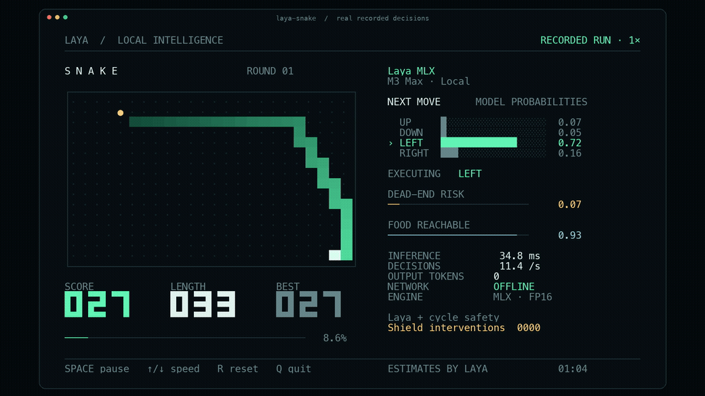

# otsone

**OpenJev 自研的校准型结构化决策模型工具包** —— Choice / Score / Noul，面向 CPU/边缘与 Apple silicon。

`otsone-1`（模型家族 **`openjev`**）是本仓库从零训练的紧凑结构化决策模型：rank-consistent 的 CORN 序数头、校准原生训练，以及严格正当的可靠性报告（gold 集 **准确率 1.0 / ECE 0.094**，[方法](docs/RESEARCH-OTSONE.md)）。它通过纯标准库的 ONNX sidecar 提供服务，在普通 CPU/边缘和 Apple silicon 上均可运行。

本工具包**同时运行 Laya 系列模型**（Convai Innovations，Apache-2.0），在 Apple silicon 上通过 MLX 原生推理。Laya 是这里受支持并已署名的一个模型，而非项目品牌；MLX 引擎（`laya_mlx`）沿用其名，因为它正是 `otsone-1` 所依托的 Laya 架构实现。

[English](README.md) · [otsone-1 模型](docs/OUR-MODEL.md) · [otsone 研究](docs/RESEARCH-OTSONE.md) · [完整 benchmark](BENCHMARKS.md) · [Snake 使用说明](docs/SNAKE_DEMO.md)

## 快速开始

```bash
pip install otsone
```

主命令为 `otsone` 与 `otsone-serve`；`laya-mlx`、`laya-serve` 保留为向后兼容别名。

### otsone-1 —— 旗舰模型（训练 → 评测 → 服务）

`otsone-1` 在本仓库训练，通过 ONNX 后端在 CPU/边缘上提供服务：

```bash
pip install 'otsone[train]'
otsone distill --backbone otsone-base --out models/otsone-base      # 训练
otsone eval    --model models/otsone-base                            # gold 评测 + 可靠性
OTSONE_BACKEND=onnx OTSONE_MODEL_PATH=./models/otsone-base otsone-serve
```

sidecar 优先读取 `OTSONE_*` 设置，未设置时回退到 `LAYA_*` 别名。架构、语料与校准细节见 [docs/OUR-MODEL.md](docs/OUR-MODEL.md)。

### 运行一次结构化决策（Laya 模型，Apple silicon）

开箱即用的推理路径使用已发布的 Laya 检查点（Convai Innovations，Apache-2.0）：

```python
import otsone  # 公开 API；也可 `import laya_mlx as laya`

agent = otsone.load("aac6fef/laya-multilingual-mlx")
result = agent.predict(
    "发票被重复扣款，请退款。",
    {
        "department": {
            "type": "choice",
            "instructions": "Who should handle this?",
            "criteria": ["billing", "technical", "sales"],
        }
    },
)
print(result["answers"]["department"])
```

运行贪吃蛇演示（由 Laya 模型驱动的真实本地对局）：



```bash
pip install 'otsone[demo]'
hf download aac6fef/laya-multilingual-mlx
laya-snake
```

提前下载一次权重，游戏运行期间完全本地推理。终端至少 104 列 × 35 行；空格暂停、↑/↓ 调速、R 重开、Q 退出。`--max-speed` 持续满速运行，每一步等待新的模型结果。

`laya-snake --optimize --max-speed` 启用已验证的编译与前缀复用路径。同轮成对测试中，2,400 步达到 **75.40 步/秒**，零死亡、安全接管 2 次，比 eager 基线快约 **6.5%**。[完整游戏表现、优化测量和一致性证据](docs/SNAKE_OPTIMIZATION.md)。

## Laya 模型 M3 Max 实测

下表测量的是 **Laya 系列模型**在 MLX 引擎上的时延（Apple silicon 路径）；`otsone-1` 自身的质量指标（准确率 / ECE / 可靠性）见 [docs/RESEARCH-OTSONE.md](docs/RESEARCH-OTSONE.md)。

| FP16，端到端 | Laya 421M | Multilingual 322M |
|---|---:|---:|
| 单个短问题 P50 | **13.42 ms** | **7.39 ms** |
| 单个短问题 P95 | **13.92 ms** | **7.79 ms** |
| 50 问题吞吐量 | **146.8 q/s** | **395.0 q/s** |
| 单个短问题 MLX 峰值分配 | **943.6 MiB** | **687.6 MiB** |

硬件为 M3 Max（40 核 GPU、128 GiB 内存）。计时包含提示准备、tokenization、张量构建、GPU 同步推理、校准及结果格式化，排除模型加载。50 问题吞吐量使用 `batch_size=64`，公开 API 默认为 16。

**移植一致性：**三个检查点在 FP32 和 FP16 下均通过 **63/63** 验证问题的上游 argmax 对齐，合计 378/378；每个配置各执行 100 次重复调用，结果有限、确定，测得活跃内存增长为零。它验证移植保真度，不代表所有实际问题都能答对。[完整误差和原始记录](BENCHMARKS.md)。

`choice` 返回分类概率，`score` 返回有序评分，`noul` 返回 P(true)。每个问题作为独立行经过双向编码器；不宣称任意问题可以复用同一份 state hidden states。本项目是独立 MLX 移植，并非 Convai Innovations 官方发布。

## 支持的检查点

| 检查点 | 编码器 | 参数量 | 最大上下文 |
|---|---|---:|---:|
| `convaiinnovations/laya` | ModernBERT-large | 421M | 512 |
| `convaiinnovations/laya-multilingual` | mmBERT-base | 322M | 1,024 |
| `convaiinnovations/laya-typed-decisions` | ModernBERT-large | 421M | 1,024 |

上下文预算包含问题、选项和输入状态。中文等非英语输入应使用 multilingual 检查点。本项目实现推理与权重转换；RLCD 训练和微调继续使用上游项目。

已转换的 FP16 MLX 权重发布在 Hugging Face，可直接传给 `laya.load(...)`：

- [aac6fef/laya-mlx](https://huggingface.co/aac6fef/laya-mlx)
- [aac6fef/laya-multilingual-mlx](https://huggingface.co/aac6fef/laya-multilingual-mlx)
- [aac6fef/laya-typed-decisions-mlx](https://huggingface.co/aac6fef/laya-typed-decisions-mlx)

例如：`laya.load("aac6fef/laya-multilingual-mlx")`。每个模型仓库都包含模型卡、测试结果、来源、许可证和文件校验清单。三个仓库共 36 个文件均已通过严格远端校验；固定版本与权重哈希见 [hub-publication.json](benchmarks/results/hub-publication.json)。

## 安装与运行

需要 Apple silicon Mac、macOS 14+ 和 Python 3.11+。本机实测环境为 M3 Max（40 核 GPU、128 GB 内存）、macOS 27.2、Python 3.12.13、MLX 0.32.2。MLX 0.32.2 提供 macOS 14 / 15 / 26 的 wheel，本机选择了 26 构建；未在这台机器上实测旧系统。

```bash
gh repo clone caelum0x/openjev
cd openjev/otsone
uv sync
uv run python examples/quickstart.py
```

或从 GitHub 直接安装：

```bash
python -m pip install 'git+https://github.com/caelum0x/openjev.git#subdirectory=otsone'
```

Python 示例：

```python
import laya_mlx as laya

agent = laya.load("aac6fef/laya-multilingual-mlx")
result = agent.predict(
    "发票被重复扣款，请今天退款。",
    {
        "department": {
            "type": "choice",
            "instructions": "Which department should handle this request?",
            "criteria": ["billing", "technical", "sales"],
        },
        "refund": {
            "type": "noul",
            "instructions": "Does the customer ask for money back?",
        },
    },
)
print(result["answers"])
```

默认使用 FP16。需要更接近原版 FP32 的数值时使用 `dtype="float32"`。`batch_size=16` 控制每次计算的问题数，更多问题会分批处理。概率按原版格式保留四位小数；不同精度可能造成小幅差异，实测误差见 benchmark 报告。

跟随上游 v0.3.5，校准温度在使用前会被钳制到 `[0.5, 5.0]`：检查点自带的 `choice:11+` 桶为 0.1006，会把 logits 锐化约 10 倍，将接近随机的答案报告成近乎确定。原始值仍可通过 `agent.temperature_raw` 和 `agent.temperature_by_options_raw` 查看，加载时会对每个被钳制的桶发出 `RuntimeWarning`。

命令行支持文本或 JSON 状态：

```bash
uv run otsone predict \
  --model aac6fef/laya-multilingual-mlx \
  --state '发票被重复扣款，请退款。' \
  --questions examples/questions.json
```

（`laya-mlx` 别名接受相同的子命令。）

本仓库已下载的权重位于 `models/` 时，将 `--model` 改成相应本地目录即可避免再次下载。

## 转换权重

```bash
uv run otsone convert \
  --model convaiinnovations/laya \
  --dtype float16 \
  --output models/laya-mlx-fp16
```

转换后可以通过 `laya.load("./models/laya-mlx-fp16")` 直接加载。输出目录包含模型、配置、tokenizer 和来源元数据。已有目录不会被覆盖，模型权重不会提交到 GitHub。

原始检查点本身存储的是 FP16 权重；这里的转换调整参数命名与计算精度，不涉及重新训练或低比特量化。

## 路由、测试和 benchmark

`Router`、`triage_questions`、`email_questions`、`guard_questions`、`moderation_questions` 等接口保留上游用法，将导入名改为 `laya_mlx` 即可。typed-decisions 检查点可通过 `task="typed_decisions"` 显式指定；`Router(preload=True)` 可预加载三个模型。模型加载/卸载由可重入锁保护，多线程并发调用会共享同一个 Agent，不会重复构建；推理本身不被串行化。

无法识别的拉丁文字语言（罗马尼亚语、波兰语、捷克语、土耳其语等）现在会依据非英语字母比例路由到多语言检查点，而不再被静默当作英语；`detect_language(state)` 会返回 `language_undecided` 和 `diacritic_rate` 等证据字段。

选项很多的 `choice` 问题可以用 `predict_shortlist` 先做 embedding 预筛（默认 top-20，余弦相似度），再只对保留的选项运行一次 `predict`;`embed_fn_from_agent(agent)` 直接复用已加载的编码器做均值池化，无需下载额外权重。该功能为显式 opt-in,`Agent.predict` 的行为不变。

详细的 API、测试和复现命令见 [英文 README](README.md)。[BENCHMARKS.md](BENCHMARKS.md) 包含本机 PyTorch MPS FP32、MLX FP32 与 MLX FP16 的端到端 P50/P95、吞吐量、内存、数值一致性、重复运行和固定抽样分类测试。所有原始测量数据位于 [benchmarks/results](benchmarks/results)，GPU 测试应串行运行。

[初步性能研究](docs/PERFORMANCE_RESEARCH.md) 分析实现、基准和 MLX 源码。针对“能否再快一个数量级”，另有两份深入报告：

- [数学分析](docs/MATH_10X_RESEARCH.md)：计算预算、带宽条件下界、真实权重谱、精确复用，以及蒸馏学生模型的设计空间。
- [工程实测](docs/ENGINEERING_10X_RESEARCH.md)：编译、量化、最后一层输出裁剪、自定义 Metal 核与矩阵乘法实验。

[experiments/](experiments) 保存研究脚本和原始数据。发布版本的结果见 [BENCHMARKS.md](BENCHMARKS.md)，各实验变体的耗时与数值一致性单独记录。

目前证据不支持相同检查点下普遍再快 10 倍。部分场景的逐轮配对中位加速约为 1.03–1.08 倍；误差区间、量化保真结果和自定义 Metal 核的实测详见工程报告。

`otsone-1`（家族 `openjev`）是本项目自研模型，权重、训练语料与 CORN/校准设计均为原创。**Laya** 及其预训练权重由 **Convai Innovations** 提供，在此作为受支持模型按 Apache-2.0 使用；MLX 引擎（`laya_mlx`）依据 Laya 与 Hugging Face ModernBERT 重实现其架构。模型输出概率不等于答案必然正确。整体采用 Apache-2.0，署名与移植说明见 [NOTICE](NOTICE)。MLX 移植最初来自 [mizorewww/laya-mlx](https://github.com/mizorewww/laya-mlx)（Apache-2.0），本工具包在其基础上增加了 ONNX 后端、CORN 序数头、校准原生训练与 `otsone-serve` 边车服务。
